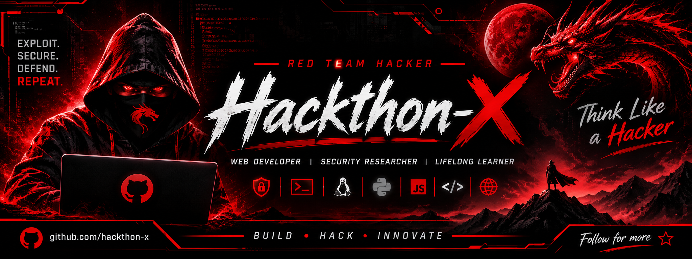

  

# 👾 hacktho-x | Red Team Operator

  

  
  
  

---

## 🧑‍💻 About Me

I'm **hacktho-x**, a cybersecurity enthusiast focused on **Red Team Operations, Offensive Security, and Ethical Hacking**.

I enjoy understanding how systems work, identifying security weaknesses, and exploring attack techniques to help strengthen digital infrastructure.

My interests revolve around simulating real-world adversarial scenarios, developing security tools, and continuously improving my technical skills.

> "Think like an attacker. Act with permission. Defend like a professional."

## 🎯 Areas of Interest

- 🔴 Red Team Operations & Adversary Simulation
- 🕵️ Penetration Testing & Vulnerability Assessment
- 🌐 Web Application Security
- 🖥️ Network & Infrastructure Security
- ⚡ Active Directory Security
- 🔍 OSINT & Reconnaissance
- 🐚 Exploit Research & Development
- 🛡️ Detection Evasion & Defensive Security Research
- 🧪 Security Automation & Scripting

## 🛠️ Technical Arsenal

**Operating Systems**
- Kali Linux
- Parrot Security OS
- Linux
- Windows

**Security Tools**
- Burp Suite
- Nmap
- Metasploit
- Wireshark
- OWASP ZAP
- Gobuster
- ffuf
- BloodHound

**Programming & Scripting**
- Python
- Bash
- PowerShell
- JavaScript

**Platforms & Labs**
- Hack The Box
- TryHackMe
- OWASP

## 📂 What You'll Find Here

My GitHub is a collection of cybersecurity-related projects, experiments, and research, including:

- 🔧 Custom security tools and automation scripts
- 🔍 Reconnaissance and enumeration utilities
- 🧪 Penetration testing methodologies
- 📚 Technical documentation and security notes
- 🛡️ Offensive and defensive security research
- 💻 Programming projects related to cybersecurity
## 📊 GitHub Statistics

  

## ⚖️ Ethical Commitment

All security research, tools, and demonstrations shared here are intended for educational purposes and authorized security testing.

I believe in responsible disclosure, ethical hacking, and using offensive security knowledge to improve cybersecurity.

**Unauthorized access is not the objective. Understanding security is.**

---

  

  <b>hacktho-x</b> | Red Team • Offensive Security • Cyber Research

  <i>Exploit knowledge. Strengthen security. Stay curious.</i>

  ⭐ Thanks for visiting my profile! Keep coding and keep growing.

